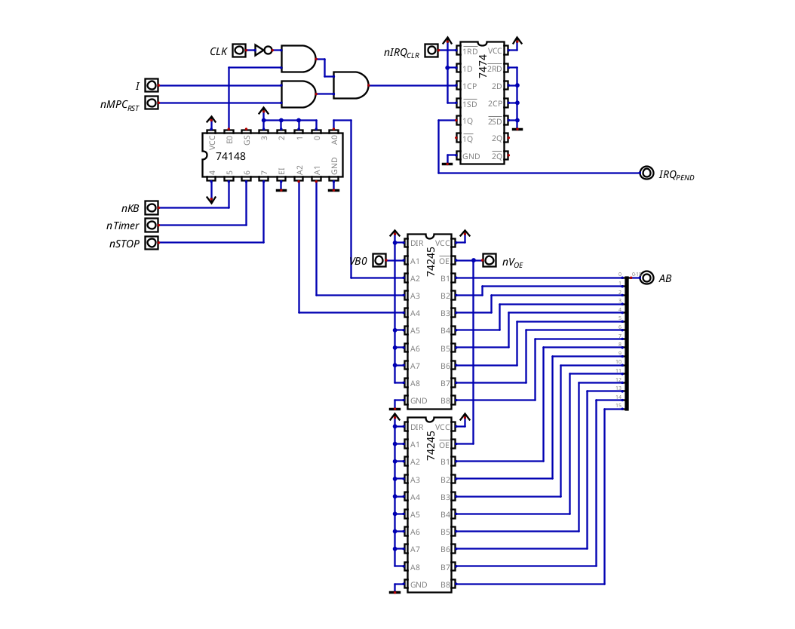
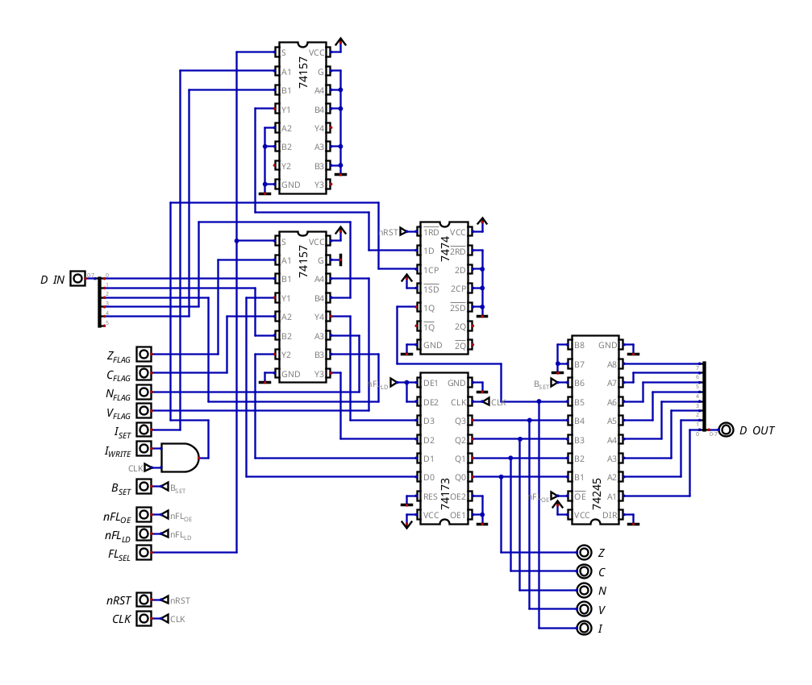

# Interrupts (and Why I'm Removing Them)

### What I Wanted

From the beginning I wanted the SFD-8 to have hardware interrupts, so that devices like the keyboard, a timer or a stop button could stop whatever the CPU was doing, run a routine and go back. The idea was also to have a software interrupt (`BRK`) and, at some point, maybe even a small OS running on top of it.

I did build them, and they worked (most of the time). This file explains how they worked, what went wrong, and why, for my criteria, they are not worth keeping in this CPU.

### How They Worked

The interrupt system is spread over three parts of the CPU.

The interrupt module (`INTERRUPTS.dig`) is where the requests come in. The three sources (`nKB`, `nTimer` and `nSTOP`) go into a 74148 priority encoder, so if two of them arrive at the same time, the one with more priority wins. The output of the encoder selects which vector is put on the address bus (through two 74245, enabled with `nV_OE`), and a 7474 latches the request as `IRQ_PEND`. The request is only accepted at the end of an instruction (it looks at `nMPC_RST`) and only if the I flag is set.

The I flag lives in the flag register (`FLAG_REG.dig`), in its own 7474, separate from the ALU flags, and it's written with `I_SET` and `I_WRITE`. There is also `B_SET`, which forces the B (break) flag to 1 when the flags are pushed by a `BRK`, so a routine can tell a software interrupt from a hardware one.

Finally, in the control unit, `IRQ_PEND` is the 17th address bit of the microcode EPROMs. When it's 1, the CPU runs a completely different microcode sequence instead of the normal fetch:

| Step | What it does                                                     |
| ---- | ---------------------------------------------------------------- |
| 0    | push PCH                                                         |
| 1    | push PCL                                                         |
| 2    | push the flags (B = 0)                                           |
| 3    | read the low byte of the vector into the IR                      |
| 4    | IR --> MARL                                                      |
| 5    | read the high byte of the vector (`V_B0`) into the IR            |
| 6    | IR --> MARH                                                      |
| 7    | MAR --> PC                                                       |
| 8    | reset the micro-PC, write the I flag and clear the IRQ latch     |

Then the routine runs, and `RTI` pops the flags and the PC back (6 cycles). `BRK` does the same as the hardware sequence, but as a normal instruction and with B = 1.

### What Went Wrong

They don't work 100% of the time. Sometimes an interrupt runs perfectly and sometimes the program ends up somewhere it shouldn't. I never found the exact cause, but these are the main suspects:

- Clearing the IRQ in step 8. When `nCLR_IRQ` clears the latch, `IRQ_PEND` goes to 0, and since it's an address bit of the EPROMs, the control unit switches to the normal microcode in the middle of that same cycle. At that point the IR holds the high byte of the vector, not an instruction, so for the rest of the cycle the control bits are whatever that "opcode" has on step 8. It depends on the timing, which would explain why it only fails sometimes.
- The I flag on entry. The sequence writes I = 1, which is the same as `SEI`, so interrupts stay enabled inside the routine. If a source is still active (for example, a key that is still pressed), the routine can be interrupted by itself.
- The MAR gets destroyed. The sequence uses the MAR to hold the vector, so whatever the interrupted program had in the MAR is lost. And there is no instruction to read the MAR into a register, so the routine can't even save it beforehand. Any program that uses the MAR can break if an interrupt arrives at the wrong moment.

The last one is not even a timing bug, it's a design problem: fixing it would need new hardware just to save and restore the MAR.

### Why It's Not Worth It

First, the cycles. Entering an interrupt takes 9 cycles and `RTI` takes 6, before the routine does anything useful (and it usually has to save some registers too). To be fair, this is about the same as the 6502 (7 and 6), so it's not a crazy number, but for a CPU like this one it means every interrupt costs around 20 cycles of overhead.

Second, robustness. My goal is to build this CPU on breadboards, and a bug that only happens sometimes and depends on timing is already hard to find in Digital. On a breadboard, with real propagation delays, it would be much worse. I prefer a CPU that does less but always works.

Also, nothing this CPU runs actually needs them: the keyboard and the timer can be read by polling their status in the MMIO, which is simpler and always predictable.

And removing them also frees a lot of things:

- The 17th address bit of the control unit, so the microcode needs half the space.
- 6 control bits: `B_SET`, `I_SET`, `I_WRITE`, `nCLR_IRQ`, `nV_OE` and `V_B0`.
- 4 instructions in opcode 31: `BRK`, `RTI`, `SEI` and `CLI`.
- The chips of the interrupt module: the 74148, two 74245, the 7474 of the IRQ latch and the 7474 of the I flag, plus some gates.
