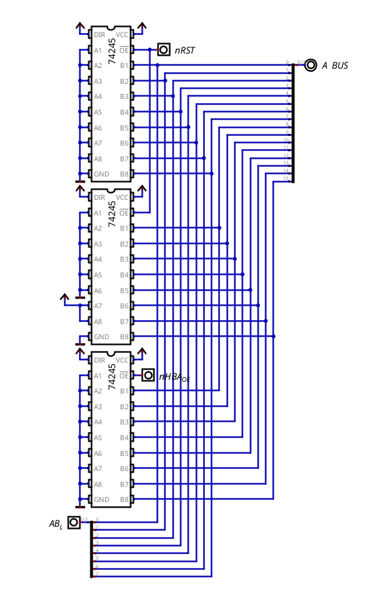

# Address Buffers

## Overview

This module has the two buffers of the CPU that don't buffer anything from another module. Their inputs are hardwired to a fixed value, so when they are enabled, they put that value on the address bus:

| Buffer              | Chips   | Drives                        | Value    | Enabled by | Used for                   |
| ------------------- | ------- | ----------------------------- | -------- | ---------- | -------------------------- |
| Address High Buffer | 1 74245 | upper byte of the address bus | `0x00`   | `nHBA_OE`  | zero-page instructions     |
| Reset Buffer        | 2 74245 | the whole address bus         | `0xC000` | `nRST`     | starting the PC at the ROM |

Both work the same way: the A side of the 74245 is tied to VCC or GND, and the output enable decides whether that value reaches the bus or not. When they are disabled, their outputs are high impedance, so they don't affect the bus at all.

## Hardware Architecture

| Pin       | Direction | Function                                                    |
| --------- | --------- | ----------------------------------------------------------- |
| `nHBA_OE` | in        | enables the Address High Buffer (active-low)                |
| `nRST`    | in        | enables the Reset Buffer (active-low, straight from the reset synchronizer) |
| `AB_L`    | in        | lower byte of the address coming from the IR (zero page)    |
| `A BUS`   | out       | the 16-bit address bus                                      |

`AB_L` doesn't go through any buffer here, it's the lower byte of the address that the IR already puts out through its own 74245 (with `nIRA_OE`). It's joined with the upper byte in this module just so that the whole zero-page address comes out of the same place.

### Address High Buffer

The zero-page instructions (`LD REG, Imm` and `ST Imm, REG`) use the lower byte of the instruction as the address, so the address is `0x00:Imm`. The lower byte comes from the IR, but something has to put `0x00` on the upper byte, and that's what this buffer does. It's a single 74245 with all of its inputs connected to ground, enabled with `nHBA_OE`.

Since the PC drives the address bus by default, the zero-page instructions also activate `PC_OE` to disconnect it. So a zero-page access is `PC_OE` + `nIRA_OE` + `nHBA_OE` together (more about the IR side in `instregister.md`).

### Reset Buffer

When the CPU starts, the PC has to begin at `0xC000`, the start of the ROM (see `memory_map.md`). The Reset Buffer is 2 74245 with that address hardwired:

- the upper one has `0xC0` on its inputs (only the 2 MSB connected to VCC)
- the lower one has all of its inputs connected to ground (`0x00`)

During the reset, this buffer drives `0xC000` onto the address bus, and the PC loads it. At the same time, the PC stops driving the address bus and the EPROMs of the Control Unit are turned off, so nothing else is driving it. How the whole reset works is explained in `reset.md`.

## Control Signals

| Signal    | Active Level | Function                                             |
| --------- | ------------ | ---------------------------------------------------- |
| `nHBA_OE` | LOW          | Drives `0x00` onto the upper byte of the address bus |
| `nRST`    | LOW          | Drives `0xC000` onto the address bus                 |

## Physical TTL Mapping

| Part                | Chip            | Quantity |
| ------------------- | --------------- | -------- |
| Address High Buffer | 74245           | 1        |
| Reset Buffer        | 74245           | 2        |
