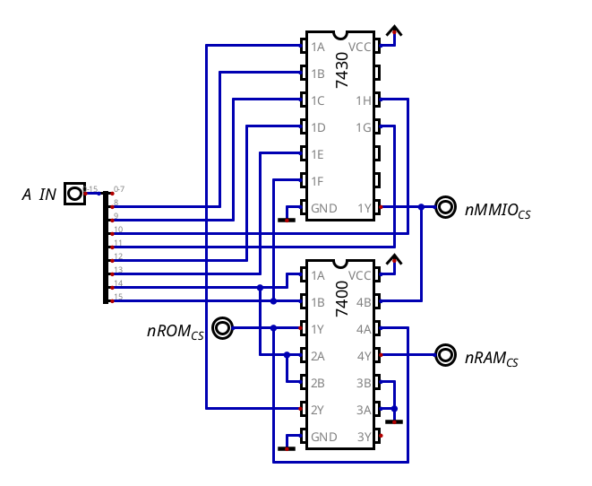

# Address Decoder

The address decoder is a module which (as the name says) decodes the chip selects of each memory module. In order to understand it work, let's see the memory map of the CPU, which will clarify what it actually does:

| Address Range   | Size     | Module         | Active Signal |
| --------------- | -------- | -------------- | ------------- |
| `0x0000-0xBEFF` | 47.75 KB | RAM            | `\RAM_CS`     |
| `0xBF00-0xBFFF` | 256 B    | MMIO registers | `\MMIO_CS`    |
| `0xC000-0xFFFF` | 16 KB    | Firmware ROM   | `\ROM_CS`     |

Its only job is to make sure that, when the address is on each address range, the specific active signal of each memory module activates, which since it's active low, goes to zero. The MMIO registers inside their block and the RAM conventions are in `memory_map.md`.

## Decoder Schematic Connections

## How It Works

Only the high byte of the address (`A8-A15`) matters here, and with a 7430 (an 8-input NAND) and a 7400 I get the 3 chip selects:

- ROM (`0xC000-0xFFFF`): it's the only range where A15 and A14 are both 1, so `\ROM_CS` is just a NAND of A15 and A14 (gate 1 of the 7400).
- MMIO (`0xBF00-0xBFFF`): the high byte has to be exactly `0xBF` = `1011 1111`, so A15 = 1, A14 = 0 and A13-A8 = 1. The 7430 only outputs a 0 when its 8 inputs are 1, so it gets A15, A13-A8, and A14 inverted. The inverter is gate 2 of the 7400 with both inputs on A14 (a NAND with its inputs together is a NOT).
- RAM (`0x0000-0xBEFF`, everything else): the RAM is selected when neither of the other two is. Since both are active low, that means `\ROM_CS` and `\MMIO_CS` are both 1, and a NAND of them (gate 4 of the 7400) gives a 0 exactly then.

This way only one chip select can be active for any address: the ROM and the MMIO need A14 at different values, and the RAM is only selected when the other two aren't. Gate 3 of the 7400 is free (inputs to ground), and the low byte isn't decoded here because the MMIO module decodes `A0-A2` by itself.