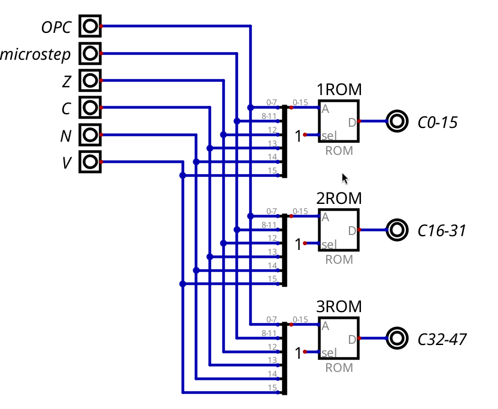

# Control Unit

## Overview

The Control Unit is what tells every other module what to do in each cycle. It's microprogrammed: instead of decoding the instructions with logic gates, it uses 3 EPROMs that work as a big lookup table. The address is "which instruction, which step and which flags", and the data stored there are the control bits for that step.

It has 2 parts:

- the 3 EPROMs, which hold the microcode
- the Micro-Program Counter (micro-PC), a 4-bit counter that says which step of the instruction the CPU is in

The microcode itself is generated by `programs/crom_programmer.py`. What each control bit does is in `opcodes&microinstructions/controlbits.md`, and the control bits of every instruction, step by step, are in `opcodes&microinstructions/instructionset_extended.md`.

## Hardware Architecture

The 3 EPROMs share the same 16-bit address, and each one outputs 16 control bits, so 48 in total:

| Address bits | Input       | Comes from                                   |
| ------------ | ----------- | -------------------------------------------- |
| `[7:0]`      | `OPC`       | upper byte of the IR: base opcode + `[10:8]` |
| `[11:8]`     | `microstep` | Micro-PC                                     |
| `12`         | `Z`         | Status register                              |
| `13`         | `C`         | Status register                              |
| `14`         | `N`         | Status register                              |
| `15`         | `V`         | Status register                              |

| Output   | EPROM | Bits                                    |
| -------- | ----- | --------------------------------------- |
| `C0-15`  | 1ROM  | control bits 0-15                       |
| `C16-31` | 2ROM  | control bits 16-31                      |
| `C32-47` | 3ROM  | control bits 32-40 (41-47 are unused)   |

16 address bits means 64K words per EPROM. Most of them are never used, but the programmer writes every address anyway, so there's nothing undefined in them.

Since the opcode input is the whole upper byte of the IR, the EPROMs also see bits `[10:8]`. That's how the sub-opcodes work without any extra decoding hardware (more about this in `design-decisions/instruction-set-redesign.md`).

### Micro-Program Counter

The micro-PC is a single 74163, a 4-bit synchronous counter. It counts up on every clock, and its output is the `microstep` input of the EPROMs. 4 bits means up to 16 steps per instruction, but the longest one (`CALL label`) only takes 7.

At the end of every instruction, the microcode activates `nMPC_RST` in the last step. The 74163 has a synchronous clear, so the counter doesn't reset right away, it goes back to 0 on the next clock edge. This way the last step still runs for a full cycle, and the next cycle is step 0 of the next instruction.

## Operation

Every instruction goes through the same loop:

1. Step 0 is the fetch (`MEM_RD`, `nIR_LD`). It's the same for every opcode, which matters, because during step 0 the IR still holds the previous instruction, so the EPROMs are still being addressed with the old opcode. The new instruction is loaded into the IR on the clock edge at the end of the step.
2. From step 1 on, the EPROMs see the new opcode, and they output the control bits of that instruction for each step. Step 1 always does `PC_INC` too (see `design-decisions/fetch-execute-overlap.md`).
3. The last step activates `nMPC_RST`, and the micro-PC goes back to 0.

Since the flags are part of the address, anything that depends on them is just a different word in the EPROMs, with no extra logic:

- Conditional jumps: if the condition is true, the microcode loads the new address. If it's false, it skips it.
- `ADC` and `SBC`: `ALU_CIN` is only activated when the carry is set.

The flags come straight from the status register, so when an instruction changes them, the new flags only reach the EPROMs on the next clock edge, like any other register.

### HALT

`HALT` stops the CPU by freezing the micro-PC. The control bit `nHALT` is wired to ENP and ENT, the count enables of the 74163. It's active-low, so in every normal step it's 1 and the counter counts. When it goes to 0, the counter stays in the same step on every clock edge.

| Step | Control bits       | What happens                                           |
| ---- | ------------------ | ------------------------------------------------------ |
| 0    | `MEM_RD`, `nIR_LD` | normal fetch                                           |
| 1    | `PC_INC`           | normal overlap, the PC points to the next instruction  |
| 2    | `nHALT`            | the micro-PC stays here, and nothing else is active    |

The clock keeps running, but since the EPROMs keep outputting the same word, with no loads, no `PC_INC` and no memory access, nothing changes. It can't freeze in step 1, because step 1 always does `PC_INC`, and the PC would keep counting. Step 2 also can't activate `nMPC_RST`, because the clear of the 74163 has priority over the enables, so it would reset the counter anyway.

The only way out is the manual reset button.

## Timing

The EPROM outputs aren't latched. After every clock edge, the address changes (new microstep, new opcode or new flags), and while the EPROMs settle, their outputs can glitch for a short time (up to the access time of the chip).

For anything edge-triggered (registers, counters, the IR) this doesn't matter, because they only sample their control bits on the next clock edge, when the outputs are already stable. It could matter for level-sensitive signals, mainly `MEM_WR` on the RAM, since a glitch could write to the wrong address. It works fine in the simulation, but I haven't looked into it yet for the real hardware. A common fix is to only let `MEM_WR` through during the second half of the clock cycle, gating it with the clock. This is an open point for the breadboard phase.

## Design Justifications

### Why Microcode

Hardwiring every single instruction would take a lot of ICs, and it would be quite complicated to design and debug. With microcode, the whole Control Unit is 3 EPROMs and a counter, which fit on a single breadboard. It's also how I did it in my previous CPUs, and it worked out well.

It also fits how the instruction set was designed. The instruction set changed all the time while the hardware progressed, and with microcode, changing an instruction only means changing `crom_programmer.py` and reprogramming the EPROMs, not rewiring anything.

### Why 3 EPROMs

The CPU needs 41 control bits. Each EPROM outputs 16, so 2 would only give 32, and 3 give 48, leaving 7 free bits for the future.

## Physical TTL Mapping

| Part       | Chip                        | Quantity |
| ---------- | --------------------------- | -------- |
| Micro-PC   | 74163                       | 1        |
| Microcode  | 27C1024 (64K x 16 EPROM)    | 3        |

The 27C1024 matches the simulation exactly: 16 address bits and 16 outputs, so the same 3 hex files from `crom_programmer.py` go straight into the chips. It's a UV-erasable EPROM, so reprogramming it means erasing it under UV light first, and the programmer has to support it.
