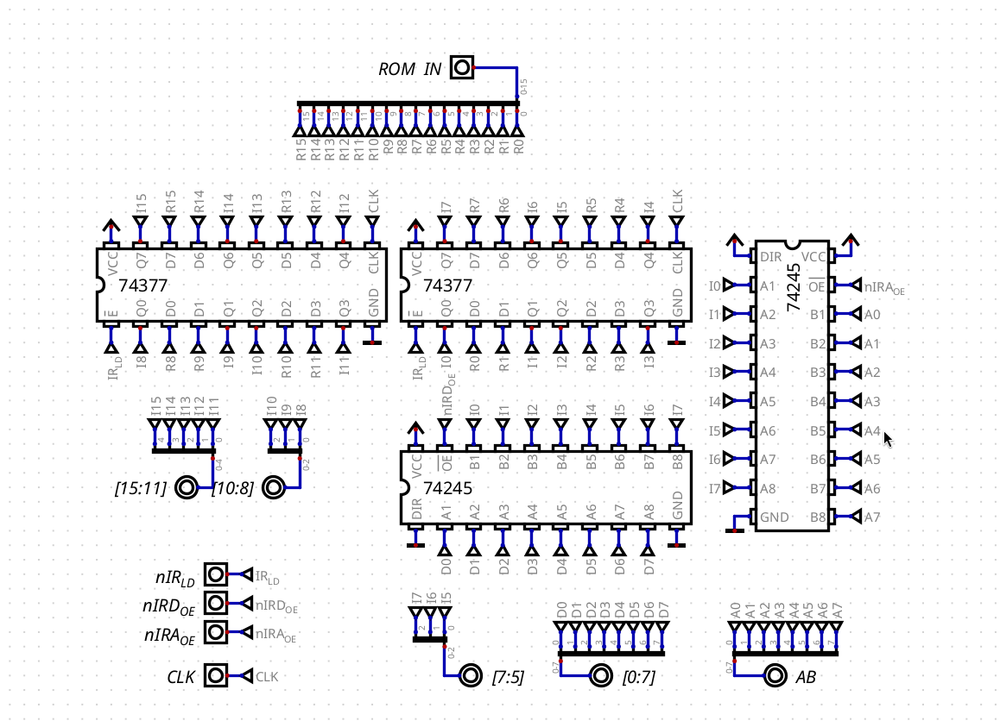

# Instruction Register

## Overview

The Instruction Register (IR) holds the 16-bit instruction that is being executed. It's loaded in step 0 of every instruction (the fetch), straight from the ROM, and it keeps that value until the next fetch.

The two bytes are used in different ways:

- The upper byte `[15:8]` (the opcode) is always being output, because the Control Unit needs it in every step to know what to do.
- The lower byte `[7:0]` (the immediate) can do three things: output nothing, output to the data bus (for immediates like `MOV REG, Imm`), or output to the lower byte of the address bus (for the zero-page instructions, together with the Address High Buffer in `address_buffers.md`, which forces the upper byte to `0x00`).

## Hardware Architecture

The IR is made of 2 74377, 8-bit registers, one for each byte. The lower byte also has 2 74245 buffers, one towards the data bus and one towards the address bus.

The connections in the simulation are made with tunnels, so the schematic is not the easiest to follow, but the idea is simple:

| Bits      | Goes to                                                                          |
| --------- | -------------------------------------------------------------------------------- |
| `[15:11]` | Control Unit (base opcode)                                                       |
| `[10:8]`  | Control Unit (subOp / condition), and the register file (destination register, and the source register in `ST Imm, REG` through the `SRC_SEL` mux) |
| `[7:5]`   | Register file (source register), straight from the 74377, without going through a buffer |
| `[7:0]`   | Data bus through a 74245 (`nIRD_OE`), and lower byte of the address bus through another 74245 (`nIRA_OE`) |

`[15:11]` and `[10:8]` together are the `OPC` input of the Control Unit. More about what each field means in `opcodes&microinstructions/isa.md` and `design-decisions/instruction-set-redesign.md`.

## Control Signals

| Signal    | Active Level | Function                                                           |
| --------- | ------------ | ------------------------------------------------------------------ |
| `nIR_LD`  | LOW          | Loads the instruction from the ROM on the next clock edge          |
| `nIRD_OE` | LOW          | Outputs the lower byte to the data bus                             |
| `nIRA_OE` | LOW          | Outputs the lower byte to the lower byte of the address bus        |

### Operations

| Operation                                    | Signals triggered               |
| -------------------------------------------- | ------------------------------- |
| Fetch (step 0 of every instruction)          | `nIR_LD` (+ `MEM_RD`)           |
| Immediate to the data bus (`MOV REG, Imm`, `ADD A, Imm`, ...) | `nIRD_OE`      |
| Zero-page address (`LD REG, Imm`, `ST Imm, REG`) | `nIRA_OE` (+ `nHBA_OE`)     |

## Timing

The 74377 loads on the rising clock edge, and only when `nIR_LD` is low. This means the new instruction is only in the IR at the end of step 0, so during the fetch the Control Unit still sees the previous opcode. That's why step 0 has to be the same for every instruction (more about this in `controlunit.md`).

## Design Justifications

### Why the 74377

The 74377 has no output enable (its outputs are always active), but it has a load enable, so it only loads when `nIR_LD` is low, without having to gate the clock.

For the upper byte, outputs that are always active are exactly what I need, since the Control Unit has to see the opcode all the time. For the lower byte it's different, because it has to go to two different buses. A register with tri-state outputs (like the 74574) could only drive one of them, so I'd need the 74245s anyway. With the 74377, the register always holds the value, and the 245s decide where it goes, or if it goes anywhere at all.

## Physical TTL Mapping

| Part                         | Chip  | Quantity |
| ---------------------------- | ----- | -------- |
| Register (upper + lower byte) | 74377 | 2        |
| Buffers (data and address bus) | 74245 | 2        |
