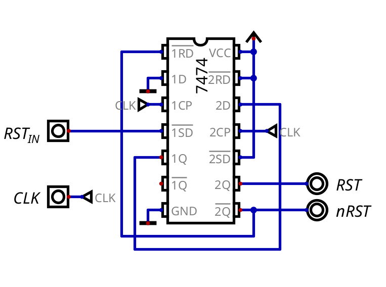

# Reset

## Overview

When the CPU starts, almost everything inside it holds random values: the PC, the IR, the micro-PC, the flags and the registers. The reset puts the CPU in a known state, so it always starts the same way:

- the PC loads `0xC000`, the start of the ROM (see `memory_map.md`)
- the micro-PC goes to step 0, so the first thing the CPU does is a fetch
- nothing else does anything while the reset is active (no loads, no writes, nothing driving the buses)

The registers A-F are cleared to 0 (`RST` goes to the reset pins of their 74173s). X, Y, the flags, the SP and the MAR are not reset, so the program has to initialize whatever it uses.

The reset is a button. To reset the CPU, I press it and release it while the clock is running (or while I pulse the manual clock). It doesn't matter when I press it, or for how long, and there's no manual sequence to follow.

## Hardware Architecture

The reset touches 6 parts of the CPU:

| Part                          | What it does during reset                                         |
| ----------------------------- | ----------------------------------------------------------------- |
| Reset synchronizer (`RST_HARDWARE.dig`) | turns the button into `RST` / `nRST`, synced with the clock |
| Reset Buffer                  | drives `0xC000` onto the address bus (see `address_buffers.md`)   |
| Program Counter               | stops driving the address bus and loads `0xC000`                  |
| Control Unit                  | the EPROMs turn off, and the micro-PC is cleared                  |
| ALU                           | clears A                                                          |
| Register File                 | clears B-F (X and Y aren't cleared)                               |

### Reset Synchronizer



The button goes through a 7474 (2 D flip-flops) before reaching the rest of the CPU, so `RST` and `nRST` only change right after a clock edge, never in the middle of a step:

| Pin   | Connected to                  |
| ----- | ----------------------------- |
| /PRE1 | the button (`RST_IN`, active-low) |
| D1    | GND                           |
| Q1    | D2                            |
| Q2    | `RST`                         |
| /Q2   | `nRST`, and back into /CLR1   |

1. When I press the button, the preset of the first flip-flop sets Q1 to 1 right away, even between clock edges, so no press gets lost, even a very short one.
2. On the next clock edge, the second flip-flop copies it: `RST` goes to 1 and `nRST` to 0. From here on, the CPU is in reset.
3. `nRST` also clears the first flip-flop through /CLR1. While the button is still pressed, the preset keeps Q1 at 1, so the reset continues.
4. Once I release the button, Q1 stays at 0 (D1 is tied to GND), and on the next edge `RST` goes back to 0.

So the reset always lasts at least one full clock cycle, and it starts and ends right after a clock edge. The edge where it ends is also the last edge the CPU sees in reset, so the PC loads `0xC000` and the micro-PC clears one last time, and the next cycle is a clean step 0.

The button is active-low because a real button is usually connected to GND with a pull-up resistor, so it's 0 when pressed. In the simulation it's a button with "Active Low" enabled, so it works the same.

### Program Counter

The PC drives the address bus by default (`PC_OE` = 0), and it would be driving it at the same time as the Reset Buffer. So the reset forces two things on the PC, no matter what the control bits say:

| PC input            | Logic                    | During reset                       |
| ------------------- | ------------------------ | ---------------------------------- |
| `/LD` (74161)       | `nPC_LD` AND `nRST`      | always 0, so it loads on every edge |
| `/OE` (74245s)      | `PC_OE` OR `RST`         | always 1, so it's off the bus      |

### Control Unit

Two things happen in the Control Unit:

- The micro-PC's clear is `nMPC_RST` AND `nRST`, so during reset the 74163 goes to 0 on every edge. The clear has priority over the enables, so this also gets the CPU out of `HALT`.
- `nRST` is connected to the output enable (`sel`) of the 3 EPROMs. During reset, they stop outputting, and every control line is pulled to its inactive value by a resistor: a pull-up for the active-low bits (`n...`) and a pull-down for the active-high ones. So during reset, every control bit is inactive.

The pull resistors are needed because otherwise the control lines would float and take random values. These are the inactive values of each EPROM (from `active_low_mask` in `crom_programmer.py`):

| EPROM | Inactive word | Pull-down bits          | Pull-up bits             |
| ----- | ------------- | ----------------------- | ------------------------ |
| 1     | `0xF3FA`      | 0, 2, 10-11             | 1, 3-9, 12-15            |
| 2     | `0xD428`      | 0-2, 4, 6-9, 11, 13     | 3, 5, 10, 12, 14-15      |
| 3     | `0x017A`      | 0, 2, 7, 9-15 (unused)  | 1, 3-6, 8 (`nHALT`)      |

## Timing

Everything in the reset happens on clock edges:

| Edge             | What happens                                                                 |
| ---------------- | ---------------------------------------------------------------------------- |
| first edge after the press | `RST` = 1. The EPROMs turn off, the PC gets off the bus, the Reset Buffer drives `0xC000` |
| every edge in reset | the PC loads `0xC000`, the micro-PC is cleared                            |
| first edge after the release | the PC and micro-PC load and clear one last time, then `RST` = 0    |
| next cycle       | step 0 (fetch) of the instruction at `0xC000`                               |

## Design Justifications

### Why AND/OR Instead of XOR

At first, the PC used 2 XOR gates: `nPC_LD` XOR `RST` and `PC_OE` XOR `RST`. It worked with the manual sequence, but an XOR inverts the control bit instead of forcing it. If the microcode had `nPC_LD` = 0 or `PC_OE` = 1 at the moment of the reset, the XOR would flip it the wrong way: the PC wouldn't load, or it would drive the address bus together with the Reset Buffer. With AND/OR, the reset wins no matter what the control bits are.

### Why Turn Off the EPROMs

The micro-PC's clear is synchronous, so in the first cycle of the reset, the micro-PC is still in whatever step the CPU was in when I pressed the button, and the EPROMs keep outputting that step. If that step had something else driving the address bus (the MAR, XY, the SP or the zero page), it would short with the Reset Buffer. In the simulation this gave a random error, depending on which instruction was running when I pressed reset.

Turning off the EPROMs during the reset means no control bit can be active, from the very first cycle. It also protects the RAM, since `MEM_WR` can't be active either. The cost is the pull resistors on the 41 control lines.

### Why Synchronize the Button

Without the 7474, the reset could start or end in the middle of a step, and I had to follow a specific order with the button and the clock. With it, the order doesn't matter anymore.

## Idea: Power-on Reset

For the breadboard, the CPU could reset itself when it's powered on, with a resistor, a capacitor and a Schmitt-trigger inverter (74HC14) in front of `RST_IN`:

```
VCC ──┤├── node ──┬── 74HC14 ── RST_IN (7474 /PRE1)
     C (1-10µF)   │
                 R (10k-100k)
                  │
                 GND

button: from node to VCC
```

At power-on the capacitor is empty, so the node starts at VCC and the CPU is in reset. As the capacitor charges, the node falls, and when it crosses the threshold of the Schmitt trigger, the reset ends cleanly (about 0.1 s with 10k and 10µF). The button goes from the node to VCC, so it also gets debounced: pressing it sets the node to VCC right away, and releasing it lets it fall slowly, so the bounces don't do anything.

I'm not sure I want it, though. I might not want the CPU to start running as soon as it gets +5V, and prefer to press the button myself. Without it, I still need to debounce the button on the breadboard, although the synchronizer already makes a bouncing button harmless (it only extends the reset a little).

## Physical TTL Mapping

| Part                      | Chip                    | Quantity |
| ------------------------- | ----------------------- | -------- |
| Reset synchronizer        | 7474                    | 1        |
| PC reset gates            | 1 AND (7408), 1 OR (7432) | shared |
| Micro-PC clear            | 1 AND (7408)            | shared |
| Control line pulls        | resistor networks (41 lines) | 5-6 |
| Reset Buffer              | 74245 (see `address_buffers.md`) | 2 |

The gates are shared with other modules on the breadboard, so they're not counted as full chips here. No inverters are needed: the 7474 outputs both `RST` and `nRST`, so every module takes the polarity it needs straight from it.
