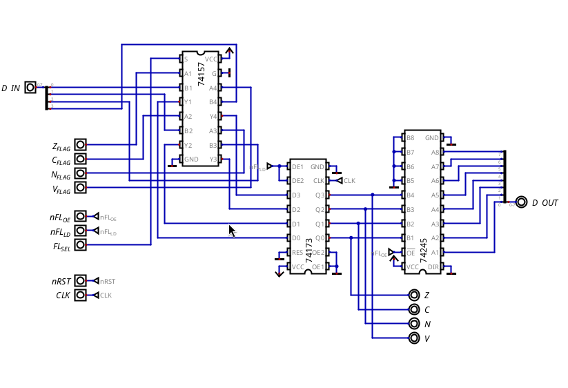

# Status Register

## Overview & Memory Layout

The Status Register (SR) is a 4-bit register that stores the ALU condition flags: Zero (Z), Carry (C), Negative (N), and Overflow (V).

The register is not programmer-visible as a general-purpose register. It is used implicitly by the CPU for conditional jumps, and it can be saved and restored through the stack with `PUSHF` and `POPF`.

When it's pushed, the flags take the lower 4 bits of the byte, and the upper 4 bits are always 0.

It used to also have the Interrupt flag (I) and the B flag, but they were removed together with the interrupts (see `design-decisions/interrupts.md`).

## Hardware Architecture & Data Path

The Status Register has two input sources, selected by a 74157 2-to-1 multiplexer:

- ALU: supplies the condition flags during normal execution.
- Data Bus: supplies the saved flags during a `POPF`.

After the MUX, the flags are stored in a 74173 4-bit register.

The register outputs feed directly into the Control Unit, so the flags can be evaluated for conditional jumps. The same outputs are also connected to a 74245 (tri-state buffer) that drives the data bus, which is how the flags get pushed onto the stack. Its 4 unused inputs are tied to ground, so the upper half of the pushed byte is always 0.

## Control Signals & Operations

| Signal   | Active Level | Function                                   |
| -------- | ------------ | ------------------------------------------ |
| `FL_SEL` | High         | Selects the input between ALU and data bus |
| `nFL_OE` | Low          | Outputs the flags onto the data bus        |
| `nFL_LD` | Low          | Loads the flags into the register          |

### Operations

| Operation        | Main Signals Triggered |
| ---------------- | ---------------------- |
| ALU instructions | `nFL_LD`               |
| `PUSHF`          | `nFL_OE`               |
| `POPF`           | `nFL_LD`, `FL_SEL`     |

(`POPF` doesn't set `FL_SEL` in the microcode yet, see `planning/issues.md`.)

## Timing, Latches & Critical Paths

The register is synchronous. Its outputs change only on the rising clock edge, after the setup time and propagation delay.
